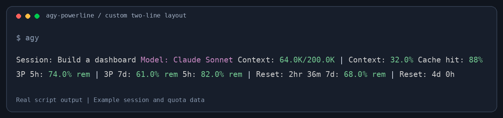

# agy-powerline

用于 Google Antigravity CLI（agy）的自定义状态栏，显示模型、上下文、配额与 Git 状态。单文件 JS，无需 npm 安装依赖。

## 效果预览



图中采用我们使用的两行布局：第一行显示会话、模型、上下文和缓存命中率，第二行显示各配额与重置时间。图片由本仓库脚本的真实终端输出渲染，会话和配额使用示例数据；不是桌面截屏，也不是默认安装样式。

## 安装

需要已安装 agy 和 Node.js 20+。以下命令适用于 macOS / Linux / WSL。

```bash
curl -fsSL https://raw.githubusercontent.com/Shimada666/agy-powerline/main/install.sh | sh
```

安装完成后重启 agy 即可。安装器自动下载脚本、备份原文件并配置状态栏，保留 agy 的其他设置及已有状态栏样式配置。再次运行同一命令即可更新；已有的 `statusLine` 命令会替换为本仓库脚本。

## 自定义

安装后，如需使用图中的样式，执行以下命令（会覆盖已有样式配置）：

```bash
curl -fsSL https://raw.githubusercontent.com/Shimada666/agy-powerline/main/examples/statusline.config.json -o "$HOME/.agy-powerline/statusline.config.json"
```

没有配置文件时使用默认样式。可在 `~/.gemini/antigravity-cli/settings.json` 的 `statusLine.command` 末尾添加参数，例如：

```text
node "$HOME/.agy-powerline/statusline.js" --preset compact --layout pills
```

支持 `--preset`、`--layout`、`--theme` 等渲染参数；也可使用 `~/.agy-powerline/statusline.config.json` 配置。已有配置可继续使用。本仓库只提供运行脚本，不包含上游的交互式配置器或 npm CLI。

## 更新与卸载

更新：重新执行安装命令，已有配置保留。

卸载：从 agy 的 `settings.json` 中删除 `statusLine` 配置，然后删除 `~/.agy-powerline/statusline.js`。

## 许可

基于 [wassim-azi/agy-powerline](https://github.com/wassim-azi/agy-powerline) 修改，采用 MIT 许可证。完整许可及原作者版权声明保留在 `statusline.js` 中。
